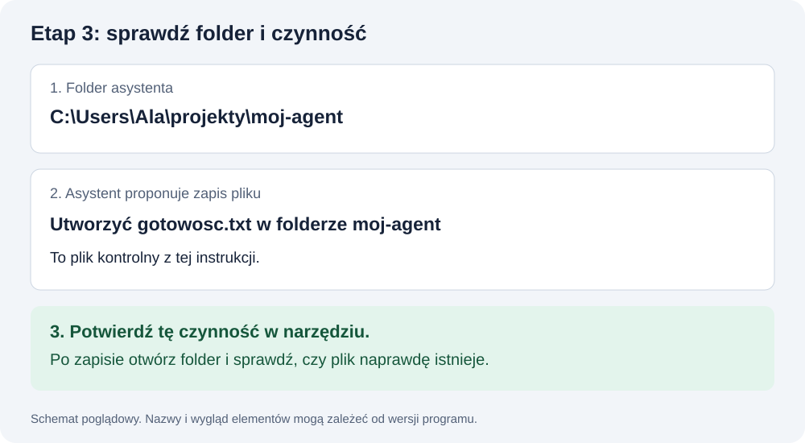

# Codex lub Claude Code — od instalacji do pierwszego pliku

**Wybierz jednego asystenta.** W obu wykonasz ćwiczenia z lekcji 1. Nie trzeba instalować dodatkowego edytora kodu.

Jeśli ktoś mówi „otwórz projekt”, chodzi o wskazanie folderu na Twoim komputerze, w którym asystent może tworzyć pliki. Samo otwarcie zwykłego czatu w przeglądarce nie potwierdza takiego dostępu.

**Czytasz pomoc do etapu 3 z README.** Numery poniżej oznaczają punkty tej instrukcji. Po teście wrócisz do etapu 4.

### Którą ścieżkę wybrać?

| Twoja sytuacja | Co zrób |
|---|---|
| Masz już asystenta, który tworzy pliki na Twoim komputerze | Wykonaj test z punktu 4 |
| Masz konto ChatGPT i chcesz pracować w terminalu | Wybierz Codex — punkt 2 |
| Masz dostęp do Claude Code w swoim planie | Wybierz Claude Desktop — punkt 3A |
| Masz tylko darmowe konto ChatGPT / Go | Sprawdź wariant aplikacji komputerowej w punkcie 2A; dostęp zależy od konta i wdrożenia |
| Nie wiesz, jaki masz dostęp | Wykonaj opisane niżej logowanie i sprawdź wynik; nie kupuj obu narzędzi |

Osobiste plany Claude Pro, Max i Ultra obejmują Claude Code; konta firmowe mogą wymagać włączenia dostępu przez administratora. Codex jest dostępny w planach ChatGPT, z różnymi limitami i dostępnością klientów. Oficjalny cennik wymienia CLI w planie Plus; Free / Go mają ograniczony dostęp do aplikacji komputerowej zależny od wdrożenia. Jeśli masz tylko darmowe konto, sprawdź dostępny klient zamiast zakładać, że każda ścieżka zadziała.

Aktualne zasady: [oficjalna dokumentacja OpenAI — plany i klienci](https://learn.chatgpt.com/docs/pricing), [Claude — dostęp do Code](https://support.claude.com/en/articles/14554922-claude-code-user-faq). Sprawdzono 02.11.2026.

## 1. Przygotuj miejsce

1. Utwórz folder **projekty/moj-agent** zgodnie z [instrukcją folderów](TERMINAL_I_PLIKI.md).
2. Sprawdź Node, npm i Git według [instalacji](INSTALACJA_I_KONTA.md).
3. Wybierz poniżej Codex albo Claude Code. Nie wykonuj obu ścieżek naraz.

## 2. Codex — wariant w terminalu

Ta ścieżka daje jednoznaczną komendę do każdego kroku. Jeśli masz już działającą aplikację Codex z lokalnym dostępem do folderu, przejdź do punktu 4.

### A. Konto

Wejdź na [ChatGPT](https://chatgpt.com), zaloguj się na swoje konto albo utwórz je w formularzu. Potwierdź adres, jeśli serwis tego wymaga. Menu profilu → Settings / Ustawienia → sekcja konta lub planu pokaże nazwę posiadanego planu. W następnym punkcie zainstalujesz klienta, a po logowaniu sprawdzisz dostęp zadaniem tworzącym plik.

**Wariant aplikacji komputerowej, jeśli z niego korzystasz:**

1. Otwórz [oficjalną instrukcję aplikacji ChatGPT z przyciskiem pobrania](https://learn.chatgpt.com/docs/app), wybierz swój system i zainstaluj aplikację.
2. Zaloguj się na to samo konto ChatGPT.
3. Wybierz Codex i lokalną pracę z folderem. Otwórz **projekty → moj-agent**; samo wybranie zwykłego czatu nie wystarczy.
4. Wykonaj test z punktu 4 tej instrukcji. Jeśli działa, pomiń instalację CLI poniżej.
5. Jeśli klient pokazuje brak dostępu lub zakup, użyj opisu zgłoszenia niżej. Nie trzeba kupować API, żeby sprawdzić dostęp na koncie.

**Ważne:** klucz OpenRouter od LABA jest dla chatbota. Nie wklejaj go do formularza logowania Codex.

### B. Instalacja

Otwórz terminal systemowy. Wklej komendę odpowiednią dla systemu.

**Windows PowerShell — po zainstalowaniu Node.js:**

```powershell
npm.cmd install -g @openai/codex
```

**macOS:**

```bash
npm install -g @openai/codex
```

`-g` oznacza instalację narzędzia poza zależnościami jednej aplikacji. W tej metodzie instalujemy oficjalny pakiet Codex z npm. Nie wpisuj tej komendy jako promptu do AI.

Poczekaj na zakończenie. Następnie zamknij terminal i otwórz nowy. Sprawdź:

| System | Komenda |
|---|---|
| PowerShell po instalacji przez npm | `codex.cmd --version` |
| macOS | `codex --version` |

**Gotowe, gdy:** pojawia się numer wersji. Błąd „not recognized” / „command not found” opisujemy w [P03](PROBLEMY.md#p03). Przy błędzie uprawnień nie dodawaj losowo sudo — przejdź do [P04](PROBLEMY.md#p04).

### C. Otwórz projekt i zaloguj się

1. W terminalu przejdź przez `cd` do **moj-agent**.
2. Sprawdź ścieżkę: Windows `Get-Location`, macOS `pwd`.
3. Uruchom:

| System | Komenda |
|---|---|
| PowerShell po instalacji przez npm | `codex.cmd` |
| macOS | `codex` |

4. Wybierz **Sign in with ChatGPT**, jeśli korzystasz z dostępu na koncie ChatGPT.
5. Dokończ logowanie w otwartej przeglądarce.
6. Wróć do terminala. Sprawdź, czy zamiast ekranu logowania widzisz rozmowę z asystentem.
7. Jeśli pojawia się pytanie o folder lub zaufanie, przeczytaj ścieżkę. Ma to być Twój projekt.
8. Jeśli narzędzie pyta o zgodę na zapis pliku w moj-agent, sprawdź opis i potwierdź tę czynność. Do testu wystarczy dostęp do tego folderu.



**Co może się pojawić po logowaniu:**

| Widzisz | Zrób teraz |
|---|---|
| Pole rozmowy i nazwę folderu | Przejdź do testu z punktu 4 |
| Stronę zgody w przeglądarce | Sprawdź konto, zatwierdź logowanie i wróć do terminala |
| Propozycję zakupu / Upgrade | Zapisz nazwę planu i klienta; sprawdź tabelę dostępu na początku tej instrukcji |
| Limit z godziną odnowienia | Zapisz termin odnowienia; instalacja ponownie nie odnawia limitu |
| Odmowę w koncie firmowym | Poproś administratora o sprawdzenie dostępu do Codex |

Jeżeli nadal nie możesz wykonać testu, zgłoś: „Etap 3, Codex CLI, system ..., plan ..., komunikat ...”. Bez hasła i danych logowania. [P05](PROBLEMY.md#p05) pomaga rozróżnić te sytuacje.

W aktywnej rozmowie Codex wpisujesz polecenia dla AI. Aby wykonać systemową komendę npm samodzielnie, otwórz drugie okno terminala w folderze projektu.

Źródła: [Codex CLI](https://learn.chatgpt.com/docs/codex/cli), [logowanie](https://learn.chatgpt.com/docs/auth), [oficjalne repo pakietu](https://github.com/openai/codex).

## 3. Claude Code — wybierz aplikację albo terminal

### A. Konto i aplikacja

1. Zaloguj się na [claude.ai](https://claude.ai) lub utwórz konto.
2. W menu konta otwórz Settings / Ustawienia → sekcję planu / Billing. Odczytaj nazwę planu. Dla konta firmowego sprawdź, czy jesteś we właściwej organizacji.
3. Pobierz [oficjalną aplikację Claude Desktop](https://claude.com/download) dla systemu.
4. Uruchom instalator, a po zakończeniu otwórz aplikację i zaloguj się.
5. Otwórz zakładkę **Code**. W nowej sesji pod polem wiadomości wybierz środowisko z grupy **Local**, potem kontrolkę folderu obok → **Open folder…**. Wskaż **projekty → moj-agent** i zatwierdź. W starszym widoku szukaj wyboru lokalnego folderu.
6. Sprawdź nazwę folderu przed wpisaniem pierwszej wiadomości. Jeśli pojawi się potwierdzenie zaufania, upewnij się, że dotyczy moj-agent.

Jeśli widzisz tylko zwykły czat, wróć do zakładki Code. Przy propozycji zakupu sprawdź plan z tabeli na początku; przy odmowie w organizacji zgłoś ją administratorowi. [Oficjalny przewodnik z widokami aplikacji](https://code.claude.com/docs/en/desktop-quickstart).

**Gotowe, gdy:** możesz wykonać test z punktu 4. Brak zakładki lub dostępu: [P05](PROBLEMY.md#p05).

### B. Wariant terminalowy

Jeśli wybrałeś aplikację i test działa, ten punkt możesz pominąć.

**Windows PowerShell:**

```powershell
irm https://claude.ai/install.ps1 | iex
```

**macOS:**

```bash
curl -fsSL https://claude.ai/install.sh | bash
```

To polecenia pobierające i uruchamiające oficjalny instalator Anthropic. Po instalacji otwórz nowy terminal, sprawdź `claude --version`, przejdź do folderu moj-agent i wpisz `claude`. Dokończ logowanie; jeśli trzeba, użyj `/login`.

Źródła: [instalacja](https://code.claude.com/docs/en/setup), [pierwsza sesja](https://support.claude.com/en/articles/14552382-your-first-day-in-claude-code).

## 4. Test: czy AI faktycznie tworzy pliki?

**Wklej do rozmowy asystenta:**

```text
Sprawdź, w którym folderze pracujesz. Podaj jego ścieżkę.
Jeśli to folder moj-agent, utwórz w nim plik gotowosc.txt z tekstem
„Gotowe do LABA”. Nie instaluj niczego i nie twórz jeszcze aplikacji.
```

**Ty:**

1. Otwórz folder moj-agent w Eksploratorze albo Finderze.
2. Znajdź **gotowosc.txt**.
3. Otwórz plik i sprawdź tekst.

**Gotowe, gdy:** plik rzeczywiście istnieje. Sama odpowiedź AI „utworzyłem” nie wystarczy.

Jeśli powstał tylko blok tekstu w rozmowie, otwórz lokalny projekt w narzędziu: [P06](PROBLEMY.md#p06).

**[Test działa → etap 4: budujesz pierwszą stronę](README.md#krok-4)** · [Wróć do etapu 3](README.md#krok-3)

## 5. Jak pracować dalej

- Prompty z lekcji wklejaj do rozmowy z asystentem, po jednym.
- Po odpowiedzi sprawdzaj pliki lub stronę.
- Jeśli asystent pyta o zgodę, sprawdź zakres. Nie włączaj pełnego dostępu tylko po to, by uniknąć pytań.
- Gdy proponuje utworzenie drugiej aplikacji, wskaż istniejący folder i poproś o kontynuowanie.
- Hasła i klucze wpisujesz lokalnie albo w panelu usługi, nie w rozmowie.

**Prompt na początek:**

```text
Jestem początkujący. Wyjaśniaj po polsku, krótko i na przykładach.
Pracuj w obecnym folderze moj-agent. Wykonuj tylko zlecony krok.
Jeśli muszę coś zrobić sam, podaj jedną czynność i poczekaj.
```

**Po przerwie:**

```text
Kontynuuję mój chatbot LABA. Nie twórz nowej aplikacji.
Sprawdź strukturę projektu i package.json bez odczytywania plików .env.
Powiedz, jak uruchomić obecną wersję.
Jestem w etapie [NUMER 1–8] z README, w pliku [NAZWA PLIKU].
```

## 6. Dwa różne logowania

| Dostęp | Co uruchamia |
|---|---|
| Twoje konto ChatGPT / Claude | Asystenta, który pisze kod |
| Klucz OpenRouter od LABA | Model odpowiadający w Twoim chatbocie |

Problem z limitem Codex nie musi oznaczać problemu z chatbotem. Błąd klucza chatbota nie oznacza, że trzeba przeinstalować Codex.

[Pomoc](POMOC.md) · [Lekcja 1](lekcja_01.md) · [Problemy z asystentem](PROBLEMY.md#p03)

Dokumentacja sprawdzona 02.11.2026. Nazwy przycisków mogą zależeć od wersji aplikacji; w razie różnic opisz to, co widzisz.
