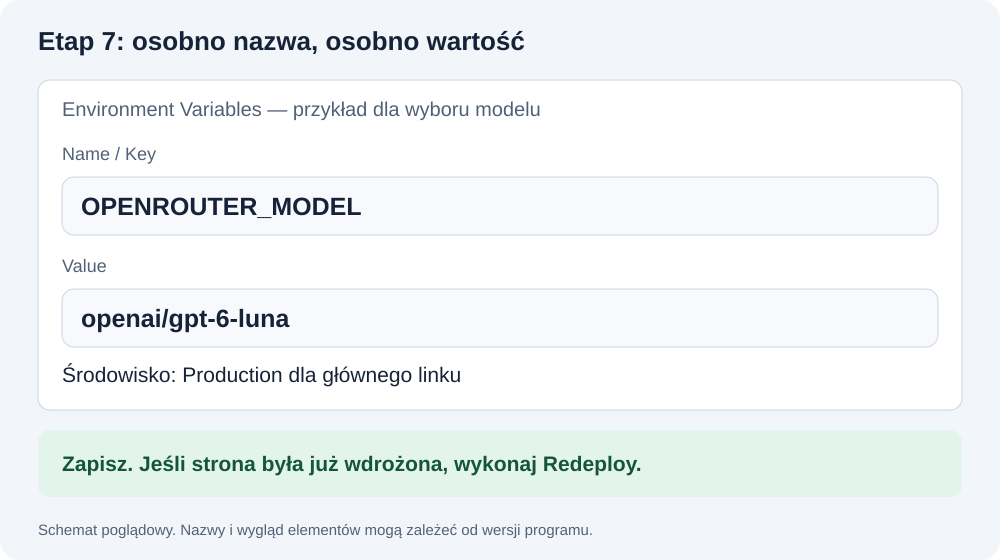

# GitHub i Vercel — od kodu na komputerze do linku

**Na końcu otwierasz link w prywatnym oknie, wpisujesz hasło i dostajesz odpowiedź AI.** Kod w GitHub i działająca aplikacja to dwa osobne etapy.

**To instrukcja etapu 7 z README; punkt 9 to końcowy test z etapu 8.** Punkty 1–10 w tym pliku są czynnościami publikacji.

## 1. Zanim zaczniesz

- Lokalna aplikacja działa.
- Hasło jest sprawdzane po stronie serwera.
- Masz cztery wartości konfiguracji z [tej instrukcji](KONFIGURACJA_I_HASLO.md).
- Jesteś w folderze aplikacji, a nie materiałów.
- Asystent sprawdził build oraz pliki przeznaczone do publikacji.

Prompt do asystenta:

```text
Przygotowuję do publikacji obecny chatbot za hasłem.
Sprawdź dostępny skrypt build, uruchom go i pokaż wynik.
Sprawdź .gitignore oraz nazwy plików w commicie, bez odczytywania sekretów.
Nie wysyłaj jeszcze kodu. Jeśli coś nie działa, napraw najmniejszy zakres.
```

**Gotowe, gdy:** build przechodzi, a sekrety nie są przygotowane do wysłania. Błąd builda rozwiąż przed publikacją: [P25](PROBLEMY.md#p25).

## 2. Konto GitHub

1. Wejdź na [github.com/signup](https://github.com/signup) albo zaloguj się na już istniejące konto.
2. Wybierz dostępny sposób rejestracji i nazwę użytkownika.
3. Dokończ wymagane potwierdzenia, w tym e-mail, jeśli pojawi się prośba.
4. Wejdź na swój profil i zapamiętaj nazwę konta.
5. Nie twórz drugiego konta tylko dlatego, że masz problem z logowaniem w terminalu.

**Gotowe, gdy:** widzisz swoje konto w serwisie. To jeszcze nie dowodzi, że terminal może wysyłać kod.

## 3. Własne repozytorium aplikacji

1. W GitHub wybierz **New repository**.
2. W polu Owner sprawdź swoje konto.
3. Nazwa: np. **moj-chatbot-laba**.
4. Visibility: możesz wybrać **Private**.
5. Jeżeli masz już lokalny kod i commit, nie dodawaj nowego README, .gitignore ani licencji.
6. Kliknij **Create repository**.
7. Na stronie nowego repo wybierz adres **HTTPS** i skopiuj go.

To adres kodu, nie gotowy link do rozmowy z chatbotem.

## 4. Wyślij kod

Pełna instrukcja z objaśnieniem poleceń: [Git krok po kroku](GIT_KROK_PO_KROKU.md).

**Przed wysłaniem kodu wykonaj [logowanie terminala do GitHub](GIT_KROK_PO_KROKU.md#logowanie)**. Znajdziesz tam instalatory dla Windows i Maca, logowanie przeglądarką oraz sprawdzenie konta. Jeśli masz już działające logowanie Git, zachowaj je.

Możesz zlecić asystentowi:

```text
Chcę wysłać obecną aplikację do mojego repo:
[WKLEJ ADRES HTTPS SWOJEGO REPO].

Sprawdź folder, stan Git, gałąź i obecny remote.
Jeśli repo lokalne nie istnieje, utwórz je dopiero po sprawdzeniu folderu.
Autora commitów konfiguruj dopiero w istniejącym repo aplikacji.
Jeśli brak logowania do GitHub, użyj instrukcji gh z materiałów kursu;
logowanie przeglądarkowe wykonam sam.
Sprawdź pliki do commita bez odczytywania sekretów.
Jeśli nie ma commita, przygotuj go z opisem obecnego działającego stanu.
Nie nadpisuj istniejącego remote ani cudzej historii.
Nie używaj force push. Nie wysyłaj kodu do repo kursu.
Jeśli potrzebne jest logowanie, podaj mi jedną następną czynność.
```

**Ty:** otwórz swoje repo i sprawdź kod. Nie powinno zawierać .env.local. Jeśli nie ma nowej wersji: [P21](PROBLEMY.md#p21) lub [P22](PROBLEMY.md#p22).

## 5. Konto Vercel

1. Wejdź na [vercel.com/signup](https://vercel.com/signup).
2. Wybierz logowanie przez GitHub.
3. Sprawdź, czy wybierasz to samo konto, na którym jest Twoje repo.
4. Dokończ wymagane potwierdzenia.
5. Dla osobistego projektu edukacyjnego wybierz plan zgodny z tym użyciem, np. Hobby, jeśli spełniasz jego warunki.
6. Wejdź do dashboardu, czyli panelu projektów.

Nie uruchamiaj płatnego planu w odpowiedzi na dowolny błąd. Jeśli panel żąda innego planu niż oczekiwany, zgłoś dokładny komunikat prowadzącemu.

## 6. Zaimportuj repo

Nazwy przycisków mogą zależeć od wersji panelu. Szukaj **Add New / New Project**, następnie **Import Git Repository**.

1. Wybierz swoje repo aplikacji.
2. Jeśli go nie ma, sprawdź konto GitHub oraz dostęp integracji Vercel do tego repo. Pomoc: [P24](PROBLEMY.md#p24).
3. Kliknij **Import** przy właściwym repo.
4. Sprawdź **Root Directory** — to katalog aplikacji. Jeśli package.json leży bezpośrednio w repo, zostaw katalog główny. Jeśli asystent utworzył podfolder, wskaż go.
5. Framework powinien odpowiadać projektowi: Next.js.
6. Nie zmieniaj komend budowania na losowe. Jeśli nie są wykryte, poproś asystenta o odczyt package.json.

## 7. Ustaw konfigurację w panelu

Przed wdrożeniem rozwiń **Environment Variables**. Jeżeli projekt już istnieje, znajdziesz je w ustawieniach projektu.

Dodaj cztery osobne wpisy:

| Name / Key | Value |
|---|---|
| OPENROUTER_API_KEY | Klucz od LABA |
| OPENROUTER_MODEL | Dokładne ID modelu od prowadzącego |
| CHAT_PASSWORD | Twoje hasło do chatbota |
| SESSION_SECRET | Sekret podpisu sesji wygenerowany lokalnie |

W Name nie wpisujesz całego wiersza ze znakiem =. W Value wpisujesz samą wartość. Nie dodawaj cudzysłowów wynikających wyłącznie ze składni .env.

Wybierz środowisko właściwe dla testowanego linku: **Production** dla głównego wdrożenia z gałęzi produkcyjnej. Jeśli testujesz **Preview**, ono również potrzebuje swoich ustawień. Ustawienia lokalne nie kopiują się automatycznie na hosting.



Nie dodawaj prefiksu NEXT_PUBLIC_ do klucza, hasła ani sekretu. Nie przesyłaj zrzutu panelu z widocznymi wartościami.

## 8. Uruchom wdrożenie

1. Kliknij **Deploy**.
2. Poczekaj na wynik. Nie odświeżaj losowo i nie uruchamiaj wielu wdrożeń naraz.
3. Sukces pozwoli otworzyć adres aplikacji.
4. Przy błędzie wejdź w **Deployments → nieudane wdrożenie → Build Logs / Building**. Sposób wybrania tekstu do pomocy pokazuje [P25](PROBLEMY.md#p25).
5. Jeśli poprawiasz kod lokalnie, zrób commit i push — przy poprawnym połączeniu Git uruchomi kolejne wdrożenie.

**Zmieniłeś konfigurację w panelu po wdrożeniu?** Uruchom **Redeploy**. Wcześniej uruchomiona wersja nie musi mieć nowych wartości.

**[Wdrożenie gotowe → przejdź do testu poniżej](#9-test-wyniku)** · [Wróć do etapu 7](README.md#krok-7)

## 9. Test wyniku

**Etap 8 z README.** Zatrzymaj lokalny serwer przez Ctrl+C i otwórz link Vercel w nowym prywatnym oknie przeglądarki. Adres localhost nie służy do tej próby.

| Próba | Oczekiwany wynik |
|---|---|
| Nowe prywatne okno i link online | Najpierw ekran hasła |
| Błędne hasło | Brak dostępu do czatu |
| Poprawne hasło | Otwiera się czat |
| Jedna wiadomość | Prawdziwa odpowiedź modelu |
| Wyjście | Dostęp ponownie wymaga hasła |
| Lokalny serwer wyłączony | Aplikacja online nadal działa |

Jeśli Vercel prosi o zalogowanie się do konta Vercel, może to być ochrona wdrożenia, a nie hasło Twojego chatbota. Zobacz [P28](PROBLEMY.md#p28).

**Gotowe, gdy:** testy przechodzą pod właściwym linkiem. Zapisz link w swoich notatkach. Nie wpisuj hasła w URL i nie publikuj go razem z linkiem w publicznym repo.

**[Testy działają → ukończ etap 8](README.md#krok-8).**

## 10. Co zapisać po zajęciach

- Link do aplikacji.
- Link do własnego repo.
- Opis ostatniego działającego commita.
- Krótką notatkę: co sprawdzono i co pozostało do poprawy.

Źródła: [Vercel i repozytoria Git](https://vercel.com/docs/git), [zmienne środowiskowe](https://vercel.com/docs/environment-variables), [konta GitHub](https://docs.github.com/en/account-and-profile/how-tos/account-management/creating-an-account-on-github).

[Wróć do etapu 7](README.md#krok-7) · [Finał: etap 8](README.md#krok-8)

[Pomoc](POMOC.md) · [Problemy](PROBLEMY.md) · [Lekcja 1](lekcja_01.md)
