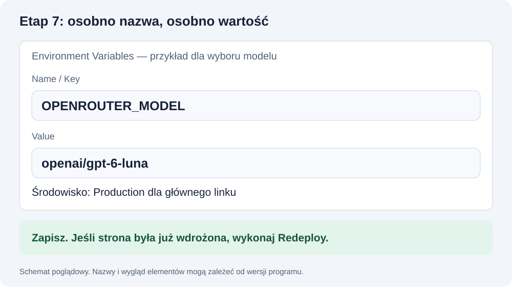

# Klucz, konfiguracja i hasło — gdzie to wpisać?

**Ten poradnik otwierasz po utworzeniu aplikacji.** Wykonuj tylko część swojego etapu:

- **Etap 5 — model:** otwórz plik według punktów 2–4, wpisz dwie zmienne w [części dla modelu](#env-model), zapisz i przetestuj odpowiedź. Nie szukaj jeszcze ekranu hasła.
- **Etap 6 — hasło:** najpierw wykonaj prompt dodający ochronę w lekcji, potem uzupełnij [część dla hasła](#env-haslo) i sprawdź dostęp.
- **Etap 7 — publikacja:** dopiero wtedy przepisz komplet czterech wartości do Vercel według punktu 7.

Numery punktów w tym pliku pomagają znaleźć czynność; etapy 1–8 pochodzą z README.

## 1. Cztery różne wartości

| Nazwa | Skąd ją bierzesz | Do czego służy |
|---|---|---|
| OPENROUTER_API_KEY | Prywatna wiadomość od LABA | Dostęp Twojego chatbota do modeli |
| OPENROUTER_MODEL | Dokładny identyfikator od prowadzącego lub z [listy modeli](MODELE_DO_CWICZEN.md), dozwolony na kluczu LABA | Wybór modelu |
| CHAT_PASSWORD | Ustalasz sam w etapie 6 | Wejście do Twojego chatbota |
| SESSION_SECRET | Generowany lokalnie przez asystenta w etapie 6 | Podpis potwierdzenia dostępu |

Hasło do chatbota nie jest hasłem do konta ChatGPT, Claude, GitHub ani Vercel. SESSION_SECRET to jeszcze inna wartość — nie wpisuje się jej w formularzu wejścia do czatu.

## 2. Gdzie jest .env.local?

W **głównym folderze aplikacji, obok package.json**. To zwykły plik tekstowy z dokładną nazwą .env.local.

Nie umieszczaj go w folderze materiałów, node_modules ani w folderze app tylko dlatego, że tam jest strona.

Najpierw sprawdź, czy plik już istnieje. W Windows włącz rozszerzenia plików; na Macu pokaż ukryte pliki. Zobacz [instrukcję plików](TERMINAL_I_PLIKI.md).

Jeśli plik już istnieje, zachowaj jego dotychczasowe ustawienia. Nie nadpisuj go pustym szablonem.

## 3. Windows: otwarcie w Notatniku

**W PowerShell w folderze aplikacji:**

```powershell
notepad .env.local
```

Otwiera plik w systemowym Notatniku. Jeśli Notatnik zapyta o utworzenie brakującego pliku, potwierdź. Po zmianach użyj **Ctrl+S**.

Przy „Zapisz jako” wybierz typ **Wszystkie pliki**, kodowanie UTF-8 i dokładną nazwę **.env.local**. Sprawdź w Eksploratorze, czy nie powstało .env.local.txt.

## 4. macOS: otwarcie pliku tekstowego

**W Terminalu w folderze aplikacji:**

```bash
touch .env.local
open -a TextEdit .env.local
```

touch tworzy brakujący plik; nie czyści treści istniejącego pliku. W TextEdit upewnij się, że pracujesz jako zwykły tekst: **Format → Make Plain Text / Zamień na zwykły tekst**, jeśli opcja jest dostępna.

Zapisz przez **Cmd+S**. Zachowaj nazwę bez dodatkowego .txt lub .rtf. W Finderze pliki z kropką pokażesz przez Cmd+Shift+kropka.

Nie używaj Worda ani formatowanego dokumentu do konfiguracji aplikacji.

## 5. Jak wygląda zapis?

<a id="env-model"></a>
### Etap 5 — klucz i model

W tym etapie potrzebujesz **dwóch wierszy**. Poniżej jest szablon z opisami — zastąp je swoimi wartościami. Nie wpisuj tych wierszy do terminala.

```dotenv
OPENROUTER_API_KEY=WPISZ_TUTAJ_KLUCZ_OD_LABA
OPENROUTER_MODEL=WPISZ_TUTAJ_DOKLADNE_ID_MODELU
```

Klucz bierzesz z prywatnej wiadomości LABA, a pełne ID modelu od prowadzącego. Jeśli nie dostałeś ID lub potwierdzenia dostępności, zgłoś brak tych danych; nie wymieniaj w ciemno klucza ani subskrypcji.

**Zapisz plik, uruchom ponownie serwer według punktu 6 i wyślij wiadomość.** Kiedy odpowiedź działa, [przejdź do etapu 6](README.md#krok-6).

<a id="env-haslo"></a>
### Etap 6 — hasło i sekret sesji

Najpierw [zleć asystentowi dodanie ekranu i sprawdzania hasła](lekcja_01.md#3-dodaj-hasło). Dopiero potem wróć do tego pliku.

Zachowaj dwa wiersze modelu. Dodaj lub uzupełnij hasło:

```dotenv
CHAT_PASSWORD=TU_WPISZ_SWOJE_HASLO
```

SESSION_SECRET ma wygenerować i zapisać lokalnie asystent zgodnie z promptem z lekcji. Nie wpisuj dosłownie tekstu „SEKRET_WYGENEROWANY_LOKALNIE”. Gdy asystent skończy, w pliku będą łącznie cztery nazwy: OPENROUTER_API_KEY, OPENROUTER_MODEL, CHAT_PASSWORD i SESSION_SECRET. Sprawdzasz je sam w pliku — nie wklejasz zawartości do rozmowy.

Po restarcie wykonaj test hasła z punktu 8. **[Hasło działa → etap 7: publikacja](README.md#krok-7).**

### Zasady zapisu dla obu etapów

- Jedna zmienna w jednym wierszu.
- Nazwa przed znakiem = musi zgadzać się z kodem.
- Po = jest wartość, nie objaśnienie.
- Nie dodawaj przecinków ani słowa export.
- Nie zostawiaj przykładowych opisów jako gotowych wartości.
- Dla hasła ze spacjami lub znakiem # użyj zwykłych podwójnych cudzysłowów zgodnie z formatem .env, np. `CHAT_PASSWORD="przykladowy tekst"`. Ten przykład nie jest hasłem do wykorzystania.
- Klucz API przepisz dokładnie, bez przypadkowej spacji lub końca wiersza.

Nie wiesz, co wpisać jako OPENROUTER_MODEL? [Tutaj znajdziesz konkretne modele i gotową linijkę do pliku](MODELE_DO_CWICZEN.md#4-wybierz-jedną-linijkę-i-zapisz). Przy zmianie modelu zachowaj klucz, hasło i sekret sesji.

W etapie 6 poproś asystenta o wygenerowanie SESSION_SECRET lokalnie i zapisanie bez wypisywania jego wartości na czacie. Przy istniejącym pliku nie powinien nadpisywać Twoich ustawień. Jego odmowa odczytania sekretu nie oznacza awarii.

## 6. Zapisz, uruchom ponownie, sprawdź

1. Zapisz plik.
2. Kliknij terminal z serwerem.
3. Ctrl+C zatrzymuje serwer.
4. Uruchom ponownie npm.cmd run dev na Windows PowerShell lub npm run dev na Macu.
5. Otwórz lokalny adres.
6. **Etap 5:** wyślij wiadomość; formularz hasła nie jest jeszcze potrzebny.
7. **Etap 6:** w nowym prywatnym oknie sprawdź błędne i poprawne hasło oraz wiadomość do czatu.

Jeśli lokalnie działa, a online nie, zobacz [P27](PROBLEMY.md#p27). Serwer internetowy ma własną konfigurację.

## 7. To samo na Vercel — inny sposób wpisywania

W panelu środowiska wpisujesz **osobno nazwę i wartość**, bez znaku =.

| Pole w panelu | Przykład formy, nie dane |
|---|---|
| Name / Key | CHAT_PASSWORD |
| Value | Tutaj samo Twoje hasło |

W Value nie dodawaj cudzysłowów tylko dlatego, że były składnią pliku .env. Ustaw odpowiednie środowisko, np. Production dla linku produkcyjnego. Po zmianie wykonaj nowe wdrożenie.

Szczegóły: [Vercel krok po kroku](GITHUB_I_VERCEL.md).



## 8. Test hasła

**Ten test wykonujesz po etapie 6, kiedy ekran hasła już istnieje.** W etapie 5 brak tego ekranu jest prawidłowy.

1. Otwórz **nowe prywatne okno** przeglądarki.
2. Otwórz adres aplikacji.
3. Sprawdź, że widzisz pole hasła.
4. Wpisz błędne hasło — czat ma pozostać zablokowany.
5. Wpisz poprawne — czat powinien działać.
6. Wybierz wyjście — po nim dostęp znowu ma być zablokowany.

Widoczny formularz nie dowodzi ochrony serwera. Dodatkowo poproś asystenta:

```text
Sprawdź, że /api/chat odrzuca żądanie bez sesji przed wywołaniem modelu.
Wykonaj tylko test odmowy dostępu, bez płatnego połączenia z OpenRouter.
Nie wyłączaj zabezpieczenia i nie wypisuj kluczy.
```

Prywatne repo na GitHub chroni dostęp do kodu. Hasło w aplikacji chroni dostęp do chatbota. To osobne rzeczy.

## 9. Czego nie udostępniać?

Nie przesyłaj .env.local, wartości klucza, hasła ani SESSION_SECRET. Bezpiecznie można podać **nazwy zmiennych**, treść błędu po ukryciu sekretów i informację „zmienna ustawiona / brak”.

Jeśli dane zostały opublikowane, otwórz [P23](PROBLEMY.md#p23).

[Wróć do etapu 5](README.md#krok-5) · [Wróć do etapu 6](README.md#krok-6) · [Wróć do etapu 7](README.md#krok-7)

[Pomoc](POMOC.md) · [Lekcja 1](lekcja_01.md)
