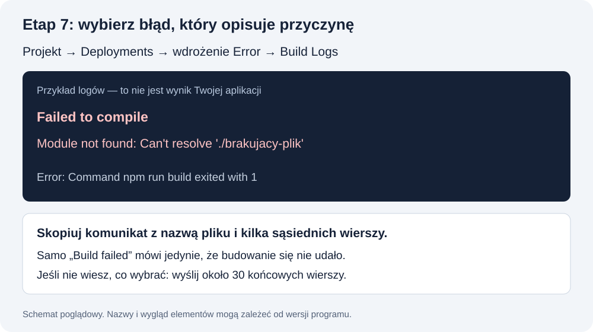

# Coś nie działa? Znajdź swój problem

**Nie reinstaluj wszystkiego.** Zacznij od komunikatu, który widzisz. Jeśli podane sprawdzenie nie pomaga, zatrzymaj się i prześlij zgłoszenie według szablonu na końcu.

**W zgłoszeniu podaj etap 1–8 z README i nazwę czytanego pliku.** Oznaczenia P01–P32 to numery problemów, nie etapy kursu.

## Szybki wybór

| Objaw | Pomoc |
|---|---|
| npm.ps1: running scripts is disabled | [P01](#p01) |
| node / npm / git: not recognized albo command not found | [P02](#p02) |
| Codex / Claude: command not found | [P03](#p03) |
| EACCES / EPERM / permission denied przy instalacji | [P04](#p04) |
| Nie mam dostępu do Code / Codex, logowanie lub limit konta | [P05](#p05) |
| AI pokazuje kod w rozmowie, ale plików nie ma | [P06](#p06) |
| ENOENT / Could not read package.json | [P07](#p07) |
| Missing script: dev / Missing script: build | [P08](#p08) |
| localhost: nie można połączyć / strona się nie otwiera | [P09](#p09) |
| Port 3000 is in use / EADDRINUSE | [P10](#p10) |
| 404 na działającym localhost | [P11](#p11) |
| Brakuje klucza / modelu / konfiguracji | [P12](#p12) |
| 401: od aplikacji czy od OpenRouter? | [P13](#p13) |
| Model niedostępny / 403 od dostawcy | [P14](#p14) |
| 429 / rate limit / brak kredytów / limit budżetu | [P15](#p15) |
| Hasło jest poprawne, ale nie wpuszcza / wpuszcza bez hasła | [P16](#p16) |
| fatal: not a git repository | [P17](#p17) |
| Please tell me who you are | [P18](#p18) |
| remote origin already exists | [P19](#p19) |
| src refspec main does not match any | [P20](#p20) |
| GitHub: Authentication failed / Permission denied / Repository not found | [P21](#p21) |
| Push rejected / non-fast-forward | [P22](#p22) |
| Klucz lub hasło trafiło do repo / wiadomości / zrzutu | [P23](#p23) |
| Vercel nie pokazuje mojego repo | [P24](#p24) |
| Vercel: build failed | [P25](#p25) |
| Po zmianie kodu online nadal stara wersja | [P26](#p26) |
| Lokalnie działa, online czat / hasło nie działa | [P27](#p27) |
| Link wymaga konta Vercel zamiast hasła chatbota | [P28](#p28) |
| Asystent robi za dużo albo utworzył kolejny projekt | [P29](#p29) |
| Zapomniałem, gdzie skończyłem | [P30](#p30) |
| Chatbot zapomniał imię po odświeżeniu | [P31](#p31) |
| Hasło działa, lecz AI mówi tylko gotowym przykładem | [P32](#p32) |

<a id="p01"></a>
## P01. npm.ps1: running scripts is disabled

**Co to może znaczyć:** PowerShell blokuje skrypt uruchamiający npm.

**Zrób teraz:** W tym samym PowerShell wpisz npm.cmd -v. W następnych komendach używaj npm.cmd install i npm.cmd run dev. Dla npx stosuj npx.cmd. Nie trzeba zmieniać ExecutionPolicy.


**Komendy do tego sprawdzenia:**

Windows PowerShell:

```powershell
npm.cmd -v
```

**Gotowe, gdy:** Pojawia się numer npm, a w folderze aplikacji można uruchomić skrypt dev.

**Jeśli nadal nie działa:** Jeśli npm.cmd też nie jest znajdowane, przejdź do P02.

<a id="p02"></a>
## P02. node / npm / git: not recognized albo command not found

**Co to może znaczyć:** System nie znajduje programu. Instalacja mogła się nie zakończyć albo obecne okno nie zna nowego PATH.

**Zrób teraz:** Zamknij terminal i otwórz nowy. Ponów node -v, npm.cmd -v (Mac: npm -v), git --version. Jeśli nadal nie działa, sprawdź, czy instalowałeś narzędzie dla swojego konta i czy instalator zakończył się poprawnie.


**Komendy do tego sprawdzenia:**

Windows PowerShell:

```powershell
node -v
npm.cmd -v
git --version
```

macOS:

```bash
node -v
npm -v
git --version
```

**Gotowe, gdy:** Komendy wypisują wersje.

**Jeśli nadal nie działa:** Podaj, która dokładnie komenda zawiodła, system i metodę instalacji. Nie edytuj losowo PATH.

<a id="p03"></a>
## P03. Codex / Claude: command not found

**Co to może znaczyć:** Program nie jest dostępny pod wpisaną nazwą w obecnym terminalu.

**Zrób teraz:** Otwórz nowy terminal. Po instalacji Codex przez npm na Windows sprawdź codex.cmd --version. Dla Claude sprawdź claude --version. Jeśli używasz wyłącznie aplikacji graficznej, brak komendy CLI nie dowodzi awarii aplikacji.


**Komendy do tego sprawdzenia:**

Poniżej sprawdzenie Codex po instalacji przez npm. Dla Claude użyj claude --version.

Windows PowerShell:

```powershell
codex.cmd --version
```

macOS:

```bash
codex --version
```

**Gotowe, gdy:** Numer wersji CLI albo udany test pliku w aplikacji.

**Jeśli nadal nie działa:** Sprawdź instrukcję instalatora i zgłoś system oraz wybraną metodę. Nie instaluj kilku kopii w ciemno.

<a id="p04"></a>
## P04. EACCES / EPERM / permission denied przy instalacji

**Co to może znaczyć:** Instalator nie może zapisać pliku; przyczyną mogą być uprawnienia, blokada pliku lub zarządzany komputer.

**Zrób teraz:** Zapisz i zamknij program korzystający z instalowanego narzędzia, otwórz nowy terminal i przeczytaj ścieżkę błędu. Jeśli problem dotyczy globalnej instalacji npm, użyj oficjalnej instrukcji instalacji dla swojego konta lub zgłoś go prowadzącemu.

**Gotowe, gdy:** Instalacja kończy się i działa sprawdzenie wersji.

**Jeśli nadal nie działa:** Nie stosuj automatycznie sudo, administratora ani zmian uprawnień całego dysku. Podaj ścieżkę i komunikat po ukryciu danych prywatnych.

<a id="p05"></a>
## P05. Nie mam dostępu do Code / Codex, logowanie lub limit konta

**Co to może znaczyć:** To problem dostępu do asystenta piszącego kod.

**Zrób teraz:** W [instrukcji asystenta](ASYSTENT_OD_ZERA.md) odszukaj tabelę wyboru i opis tego, co pojawia się po logowaniu. Odczytaj nazwę planu w ustawieniach konta. Przy ekranie zakupu zgłoś plan i nazwę klienta; przy koncie firmowym sprawdź organizację i dostęp z administratorem. Jeśli widzisz limit, odczytaj czas odnowienia. Klucz LABA nie jest zamiennikiem logowania do asystenta.

**Gotowe, gdy:** Asystent przyjmuje zadanie i tworzy lokalny plik testowy.

**Jeśli nadal nie działa:** Zgłoś nazwę narzędzia i komunikat bez danych logowania. Nie kupuj przypadkowo API, jeśli korzystasz z subskrypcji.

<a id="p06"></a>
## P06. AI pokazuje kod w rozmowie, ale plików nie ma

**Co to może znaczyć:** Możesz być w zwykłym czacie albo w innym folderze.

**Zrób teraz:** Otwórz lokalny projekt w trybie pracy z plikami. W Claude Desktop sprawdź zakładkę Code; w CLI sprawdź folder przed uruchomieniem asystenta. Wykonaj test gotowosc.txt z instrukcji asystenta.

**Gotowe, gdy:** Plik jest widoczny w Twoim folderze moj-agent.

**Jeśli nadal nie działa:** Podaj, czy pracujesz w przeglądarce, aplikacji czy terminalu. Sama deklaracja AI nie potwierdza zapisu.

<a id="p07"></a>
## P07. ENOENT / Could not read package.json

**Co to może znaczyć:** Najczęściej komenda działa w złym folderze albo projekt nie powstał.

**Zrób teraz:** Sprawdź folder przez Get-Location (Mac: pwd) i listę plików. Wejdź do katalogu aplikacji z package.json. Jeśli dopiero zaczynasz, wykonaj krok tworzenia projektu z lekcji 1.


**Komendy do tego sprawdzenia:**

Windows PowerShell:

```powershell
Get-Location
Get-ChildItem
```

macOS:

```bash
pwd
ls
```

**Gotowe, gdy:** Widzisz package.json i npm może odczytać skrypty.

**Jeśli nadal nie działa:** Nie twórz pustego package.json. Poproś asystenta o wskazanie folderu aplikacji.

<a id="p08"></a>
## P08. Missing script: dev / Missing script: build

**Co to może znaczyć:** W danym package.json nie ma polecenia o tej nazwie.

**Zrób teraz:** W folderze projektu wpisz npm.cmd run (Mac: npm run), aby zobaczyć dostępne skrypty. Poproś asystenta o sprawdzenie zgodności z projektem Next.js.


**Komendy do tego sprawdzenia:**

Windows PowerShell:

```powershell
npm.cmd run
```

macOS:

```bash
npm run
```

**Gotowe, gdy:** Wiesz, którego skryptu użyć; brakujący jest poprawnie dodany, jeśli rzeczywiście potrzebny.

**Jeśli nadal nie działa:** Nie zastępuj builda poleceniem, które tylko udaje sukces. Zgłoś listę skryptów bez konfiguracji prywatnej.

<a id="p09"></a>
## P09. localhost: nie można połączyć / strona się nie otwiera

**Co to może znaczyć:** Serwer może być zatrzymany albo adres ma zły port.

**Zrób teraz:** Otwórz terminal aplikacji, uruchom npm.cmd run dev (Mac: npm run dev) i odczytaj adres. Wklej go do przeglądarki. Terminal z serwerem zostaw otwarty.


**Komendy do tego sprawdzenia:**

W folderze aplikacji z package.json:

Windows PowerShell:

```powershell
npm.cmd run dev
```

macOS:

```bash
npm run dev
```

**Gotowe, gdy:** Strona otwiera się pod podanym adresem.

**Jeśli nadal nie działa:** Jeśli serwer kończy pracę błędem, diagnozuj ten błąd, a nie samą kartę przeglądarki.

<a id="p10"></a>
## P10. Port 3000 is in use / EADDRINUSE

**Co to może znaczyć:** Ten port jest zajęty przez inny proces, czasem wcześniejszy serwer tego samego projektu.

**Zrób teraz:** Przeczytaj, czy serwer podał inny adres, np. 3001. Użyj go. Jeśli to Twoje stare okno serwera, możesz je zatrzymać przez Ctrl+C.

**Gotowe, gdy:** Działa jedna właściwa wersja aplikacji pod znanym portem.

**Jeśli nadal nie działa:** Nie kończ wszystkich procesów node w systemie. Jeśli nie wiesz, kto używa portu, poproś o rozpoznanie procesu.

<a id="p11"></a>
## P11. 404 na działającym localhost

**Co to może znaczyć:** Serwer odpowiada, ale wskazana strona lub ścieżka nie istnieje.

**Zrób teraz:** Sprawdź, czy używasz adresu aktualnego projektu i właściwego portu. Otwórz stronę główną, bez dopisanej ścieżki. Poproś asystenta o sprawdzenie pliku strony i routingu.

**Gotowe, gdy:** Otwiera się główna strona chatbota.

**Jeśli nadal nie działa:** Nie twórz nowej aplikacji, dopóki nie sprawdzisz katalogu i istniejących plików.

<a id="p12"></a>
## P12. Brakuje klucza / modelu / konfiguracji

**Co to może znaczyć:** Kod nie otrzymał wymaganej zmiennej.

**Zrób teraz:** Sprawdź lokalnie nazwy w .env.local, folder obok package.json i brak końcówki .txt. Zapisz i uruchom ponownie serwer. Nie wklejaj zawartości pliku do rozmowy.

**Gotowe, gdy:** Komunikat o braku konfiguracji znika.

**Jeśli nadal nie działa:** Jeśli nie masz klucza lub ID modelu, poproś LABA/prowadzącego. Nie zgaduj identyfikatora.

<a id="p13"></a>
## P13. 401: od aplikacji czy od OpenRouter?

**Co to może znaczyć:** 401 może oznaczać brak sesji hasła w naszej aplikacji albo odrzucenie klucza przez dostawcę.

**Zrób teraz:** Najpierw wpisz poprawne hasło w aplikacji. Jeśli sesja działa, poproś asystenta o ustalenie źródła 401 na podstawie endpointu i bezpiecznego komunikatu serwera. Zweryfikuj klucz lokalnie bez jego pokazywania.

**Gotowe, gdy:** Przy braku sesji 401 jest poprawny; po uzyskaniu dostępu czat powinien odpowiadać.

**Jeśli nadal nie działa:** Nie usuwaj sprawdzania hasła. Przy odrzuconym kluczu skontaktuj się z LABA.

<a id="p14"></a>
## P14. Model niedostępny / 403 od dostawcy

**Co to może znaczyć:** Klucz może nie mieć uprawnień do modelu albo podane ID jest niepoprawne.

**Zrób teraz:** Porównaj OPENROUTER_MODEL z identyfikatorem otrzymanym od prowadzącego. Sprawdź dokładny komunikat dostawcy po ukryciu sekretów.

**Gotowe, gdy:** Wywołanie używa dozwolonego modelu.

**Jeśli nadal nie działa:** Poproś LABA o potwierdzenie dostępu. Nie przełączaj się sam na losowy płatny model.

<a id="p15"></a>
## P15. 429 / rate limit / brak kredytów / limit budżetu

**Co to może znaczyć:** Wyczerpano limit lub dostawca ograniczył tempo. Status związany z rozliczeniem może być inny niż 429.

**Zrób teraz:** Przeczytaj komunikat, zatrzymaj wielokrotne ponawianie i sprawdź, czy problem dotyczy asystenta kodowania, Twojej aplikacji czy klucza LABA. Jeśli podano czas ponownej próby, zastosuj go.

**Gotowe, gdy:** Po odnowieniu dostępu lub zmianie przydziału jedno wywołanie działa.

**Jeśli nadal nie działa:** Nie zwiększaj płatnych limitów w ciemno. Zgłoś usługę i bezpieczny komunikat.

<a id="p16"></a>
## P16. Hasło jest poprawne, ale nie wpuszcza / wpuszcza bez hasła

**Co to może znaczyć:** Przyczyną może być konfiguracja, stara sesja lub błąd ochrony.

**Zrób teraz:** Sprawdź CHAT_PASSWORD, zapisz konfigurację i zrestartuj serwer. Przetestuj w nowym prywatnym oknie; po zmianie SESSION_SECRET stare sesje mogą być nieważne. Na Vercel wykonaj Redeploy po zmianie zmiennych.

**Gotowe, gdy:** Błędne hasło blokuje, poprawne wpuszcza, wyjście blokuje ponownie.

**Jeśli nadal nie działa:** Jeśli endpoint działa bez sesji, zgłoś błąd asystentowi przed udostępnianiem linku. Nie akceptuj samego ukrycia formularza.

<a id="p17"></a>
## P17. fatal: not a git repository

**Co to może znaczyć:** Git nie widzi historii w obecnym folderze.

**Zrób teraz:** Sprawdź folder. Jeśli to nowa aplikacja i nie ma jeszcze Git, wykonaj git init. Jeśli repo już istnieje gdzie indziej, wejdź do niego.


**Komendy do tego sprawdzenia:**

Po sprawdzeniu folderu. git init wykonuj wyłącznie, jeśli świadomie rozpoczynasz nowe repo.

```bash
git status
```

**Gotowe, gdy:** git status pokazuje stan właściwej aplikacji.

**Jeśli nadal nie działa:** Nie uruchamiaj git init w folderze użytkownika ani nad wszystkimi projektami.

<a id="p18"></a>
## P18. Please tell me who you are

**Co to może znaczyć:** Git nie zna danych autora commita.

**Zrób teraz:** Ustaw git config user.name oraz git config user.email według instrukcji Git. Wpisz własne dane i ponów commit.

**Gotowe, gdy:** Commit powstaje z opisem zmiany.

**Jeśli nadal nie działa:** To nie hasło ani logowanie do GitHub. Nie wpisuj tam klucza API.

<a id="p19"></a>
## P19. remote origin already exists

**Co to może znaczyć:** Repo ma już zapisany adres połączenia.

**Zrób teraz:** Wykonaj git remote -v. Jeśli wskazuje Twoje właściwe repo, nie dodawaj go ponownie. Jeśli adres jest inny, pokaż asystentowi sam adres po usunięciu ewentualnych sekretów.


**Komendy do tego sprawdzenia:**

```bash
git remote -v
```

**Gotowe, gdy:** Origin wskazuje repo Twojej aplikacji.

**Jeśli nadal nie działa:** Nie nadpisuj połączenia bez sprawdzenia, szczególnie gdy wskazuje repo kursu lub cudzy projekt.

<a id="p20"></a>
## P20. src refspec main does not match any

**Co to może znaczyć:** Najczęściej brak pierwszego commita albo gałąź ma inną nazwę.

**Zrób teraz:** Sprawdź git status, git branch --show-current i git log --oneline -5. Przy braku historii log może zgłosić błąd — to wskazówka. Utwórz pierwszy commit i użyj właściwej nazwy gałęzi.


**Komendy do tego sprawdzenia:**

```bash
git status
git branch --show-current
git log --oneline -5
```

**Gotowe, gdy:** Wysłanie odnosi się do istniejącej gałęzi z commitem.

**Jeśli nadal nie działa:** Nie dodawaj force. Szczegóły zmiany nazwy są w instrukcji Git.

<a id="p21"></a>
## P21. GitHub: Authentication failed / Permission denied / Repository not found

**Co to może znaczyć:** Terminal nie ma dostępu albo adres repo jest błędny.

**Zrób teraz:** Sprawdź właściciela i adres przez git remote -v. Otwórz repo w przeglądarce na właściwym koncie. Wykonaj [logowanie przez przeglądarkę z gh, krok po kroku](GIT_KROK_PO_KROKU.md#logowanie), a następnie ponów push. Jeśli terminal pyta o Username / Password, anuluj przez Ctrl+C i wróć do tej instrukcji; nie wpisuj tam hasła do strony.


**Komendy do tego sprawdzenia:**

```bash
git remote -v
```

**Gotowe, gdy:** Push kończy się potwierdzeniem, a commit widać na GitHub.

**Jeśli nadal nie działa:** Hasła do strony nie wpisuj jako zamiennika tokenu. Nie przesyłaj tokenu do rozmowy z AI.

<a id="p22"></a>
## P22. Push rejected / non-fast-forward

**Co to może znaczyć:** Na GitHub są zmiany, których nie ma w lokalnej historii.

**Zrób teraz:** Zatrzymaj wysyłanie. Sprawdź git status oraz adres remote. Powiedz asystentowi, czy repo online utworzono z dodatkowym README lub czy pracujesz na innym komputerze.


**Komendy do tego sprawdzenia:**

```bash
git status
git remote -v
```

**Gotowe, gdy:** Historie zostają świadomie połączone, a Twoje zmiany zachowane.

**Jeśli nadal nie działa:** Nie używaj force push ani losowego resetu. Wspólne repo i zmieniona wcześniej historia wymagają osobnej diagnozy.

<a id="p23"></a>
## P23. Klucz lub hasło trafiło do repo / wiadomości / zrzutu

**Co to może znaczyć:** Sekret mógł zostać skopiowany, nawet jeśli usuniesz plik.

**Zrób teraz:** Zatrzymaj dalszą publikację. Klucz LABA zgłoś do unieważnienia i zastąpienia. Zmień ujawnione hasło oraz SESSION_SECRET, jeśli zostały ujawnione. Następnie popraw śledzenie plików i .gitignore z asystentem.

**Gotowe, gdy:** Nowe sekrety działają, stare zostały unieważnione, a pliki nie są publikowane.

**Jeśli nadal nie działa:** Nie wklejaj ujawnionej wartości ponownie do zgłoszenia. Samo usunięcie pliku lub commita nie daje pewności cofnięcia wycieku.

<a id="p24"></a>
## P24. Vercel nie pokazuje mojego repo

**Co to może znaczyć:** Konto lub integracja GitHub nie ma dostępu do tego repo.

**Zrób teraz:** Sprawdź konto, właściciela repo oraz uprawnienia integracji Vercel. Jeśli można wybrać repo, dodaj potrzebne repo aplikacji zamiast udostępniać wszystko.

**Gotowe, gdy:** Możesz wybrać właściwe repo w Import.

**Jeśli nadal nie działa:** Nie zmieniaj prywatności repo na publiczną tylko po to, by ominąć niepoprawne połączenie kont.

<a id="p25"></a>
## P25. Vercel: build failed

**Co to może znaczyć:** Proces budowania aplikacji zakończył się błędem.

**Zrób teraz:** W panelu projektu Vercel otwórz **Deployments**, wybierz wdrożenie ze statusem **Error / Failed**, a następnie **Build Logs / Building**. W logach znajdź pierwsze wystąpienie `Error`, `Failed to compile`, `Module not found` albo `Type error`. Skopiuj tę linię oraz kilka wierszy przed nią i po niej.



Na przykład: `Module not found: Can't resolve './brakujacy-plik'` mówi więcej niż ostatnie ogólne `Build failed`. To przykładowy błąd, nie polecenie do wykonania.

Jeśli nie wiesz, którą linię wybrać, skopiuj końcowe około 30 wierszy po sprawdzeniu, czy nie ma tam sekretów. Nie musisz sam diagnozować kodu. Przekaż asystentowi tekst z dopiskiem: „Etap 7, plik GITHUB_I_VERCEL.md, Vercel nie zbudował aplikacji”. Sprawdzenie folderu i package.json zleć asystentowi.


**Komendy do tego sprawdzenia:**

Jeśli projekt ma skrypt build; pracuj w folderze aplikacji.

Windows PowerShell:

```powershell
npm.cmd run build
```

macOS:

```bash
npm run build
```

**Gotowe, gdy:** Build kończy się poprawnie na właściwej wersji kodu.

**Jeśli nadal nie działa:** Nie wyłączaj sprawdzania błędów ani nie zastępuj komendy build pustym sukcesem.

<a id="p26"></a>
## P26. Po zmianie kodu online nadal stara wersja

**Co to może znaczyć:** Zmiana mogła zostać tylko lokalnie albo nowe wdrożenie nie przeszło.

**Zrób teraz:** Sprawdź kolejno: zapis pliku, commit, push, nowy commit na GitHub, status wdrożenia w Vercel i otwierany adres. Sprawdź powiązanie wdrożenia z wersją kodu.

**Gotowe, gdy:** Pod właściwym linkiem widzisz nową wersję.

**Jeśli nadal nie działa:** Nie odświeżaj bez końca. Jeśli nowe wdrożenie jest błędne, przejdź do P25.

<a id="p27"></a>
## P27. Lokalnie działa, online czat / hasło nie działa

**Co to może znaczyć:** Hosting ma oddzielną konfigurację.

**Zrób teraz:** W Vercel sprawdź cztery nazwy zmiennych i środowisko linku. Wartości wpisz sam, bez niepotrzebnych cudzysłowów. Po zmianie wykonaj Redeploy i przetestuj nowe wdrożenie w prywatnym oknie.

**Gotowe, gdy:** Hasło i odpowiedź działają w wersji internetowej.

**Jeśli nadal nie działa:** Przekaż tylko nazwy ustawionych zmiennych oraz bezpieczny komunikat, nigdy ich wartości.

<a id="p28"></a>
## P28. Link wymaga konta Vercel zamiast hasła chatbota

**Co to może znaczyć:** Może działać dodatkowa ochrona wdrożenia Vercel.

**Zrób teraz:** Sprawdź, czy otwierasz Production czy Preview i kto ma mieć dostęp. Z prowadzącym dobierz ochronę do planu; zachowaj serwerowe hasło aplikacji.

**Gotowe, gdy:** Docelowy odbiorca otwiera właściwy link i widzi uzgodniony ekran dostępu.

**Jeśli nadal nie działa:** Nie wyłączaj wszystkich zabezpieczeń w odpowiedzi na ekran logowania.

<a id="p29"></a>
## P29. Asystent robi za dużo albo utworzył kolejny projekt

**Co to może znaczyć:** Zakres zadania lub folder nie został utrzymany.

**Zrób teraz:** Zatrzymaj zadanie. Podaj obecny folder i jeden oczekiwany rezultat. Poproś o listę zmian i kontynuację istniejącego projektu, bez usuwania Twojej pracy.

**Gotowe, gdy:** Zmiany dotyczą jednego kroku we właściwej aplikacji.

**Jeśli nadal nie działa:** Nie zatwierdzaj masowego cofnięcia lub kasowania plików bez zrozumienia skutków.

<a id="p30"></a>
## P30. Zapomniałem, gdzie skończyłem

**Co to może znaczyć:** Po przerwie brak kontekstu, niekoniecznie uszkodzony projekt.

**Zrób teraz:** Otwórz właściwy folder. Poproś asystenta o sprawdzenie struktury, package.json i stanu Git bez odczytywania .env. Podaj ostatni wykonany etap 1–8 z README i nazwę czytanego pliku.

**Gotowe, gdy:** Uruchamiasz istniejącą aplikację i wracasz do jednego kroku.

**Jeśli nadal nie działa:** Nie generuj projektu ponownie, zanim sprawdzisz obecną wersję.

<a id="p31"></a>
## P31. Chatbot zapomniał imię po odświeżeniu

**Co to może znaczyć:** W lekcji 1 historia jest przechowywana w bieżącej rozmowie.

**Zrób teraz:** Sprawdź pamięć dwiema wiadomościami bez odświeżania strony. Trwały zapis rozmów będzie na późniejszych zajęciach.

**Gotowe, gdy:** W jednej sesji model zna poprzednie wiadomości.

**Jeśli nadal nie działa:** Jeśli zapomina już w tej samej sesji, poproś asystenta o sprawdzenie przekazywania historii do modelu.

<a id="p32"></a>
## P32. Hasło działa, lecz AI mówi tylko gotowym przykładem

**Co to może znaczyć:** Interfejs może zawierać atrapę lub połączenie z modelem nie działa.

**Zrób teraz:** Wyślij własne pytanie. Poproś asystenta o sprawdzenie serwerowego połączenia z OpenRouter, bez wypisywania klucza. Sam ręcznie wykonaj jedno wywołanie testowe.

**Gotowe, gdy:** Odpowiedź pochodzi z rzeczywistego modelu, a błąd połączenia jest jasno pokazany.

**Jeśli nadal nie działa:** Nie zaliczaj animacji tekstu jako dowodu połączenia z API.

## Prompt do naprawy konkretnego błędu

Wklej do Codex lub Claude Code i uzupełnij:

```text
Problem: [NUMER P Z TEJ INSTRUKCJI]
Etap 1–8 z README:
Czytany plik i punkt:
System i terminal:
Co uruchamiam:
Dokładny komunikat bez sekretów:
Co już sprawdziłem:

Ustal przyczynę w obecnym projekcie. Nie twórz nowej aplikacji.
Nie czytaj i nie wypisuj wartości z plików .env.
Napraw najmniejszy potrzebny zakres i podaj sposób sprawdzenia wyniku.
Jeżeli muszę wykonać krok ręcznie, podaj jedną czynność i poczekaj.
Nie wyłączaj hasła ani nie zwiększaj płatnych limitów, aby obejść błąd.
```

## Zgłoszenie na czat kursu

Podaj etap 1–8 z README, nazwę pliku, numer problemu P, system, narzędzie, czynność, oczekiwany wynik i bezpieczny komunikat błędu. Dopisz, co już sprawdziłeś. Zrzut powinien pokazywać problem, bez haseł, kluczy i zawartości .env.local.

Źródła do pogłębienia: [PowerShell](https://learn.microsoft.com/powershell/module/microsoft.powershell.core/about/about_command_precedence), [Claude Code](https://code.claude.com/docs/en/setup), [GitHub push](https://docs.github.com/en/get-started/using-git/pushing-commits-to-a-remote-repository), [Vercel zmienne](https://vercel.com/docs/environment-variables). Sekcje opisują możliwe przyczyny — sam kod błędu nie zawsze wystarcza do diagnozy.

[Wróć do swojej trasy w README](README.md)

[Pomoc](POMOC.md) · [Lekcja 1](lekcja_01.md)
