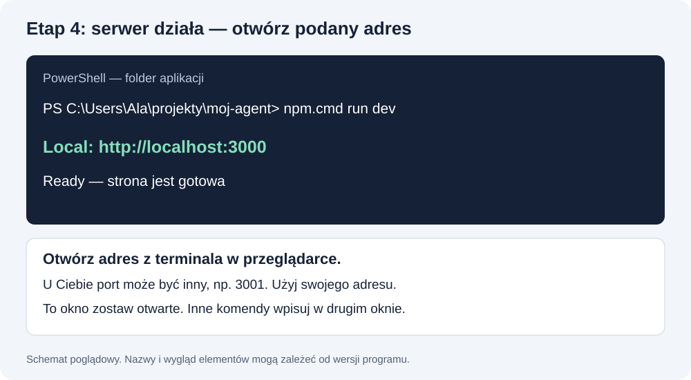

# Terminal, foldery i pliki — od pierwszego kliknięcia

**Tutaj uczysz się obsługi miejsca pracy. Komendy nie wymagają wcześniejszej znajomości programowania.**

Etap 1 z README: wykonaj punkty 1–2. Etap 2: punkt 3. Pozostałe punkty to pomoc, do której możesz wracać. To nie są nowe etapy kursu.

## 1. Otwórz terminal

### Windows

1. Naciśnij klawisz Windows.
2. Wpisz **PowerShell**.
3. Otwórz Windows PowerShell lub PowerShell.
4. Zobaczysz początek wiersza podobny do `PS C:\Users\TwojaNazwa>`.

To informacja, w którym folderze jesteś. **Nie przepisuj jej jako części komendy.** Zwykle wystarczy zwykłe okno, bez „Uruchom jako administrator”.

### macOS

1. Naciśnij **Cmd + Spacja**.
2. Wpisz **Terminal** i naciśnij Enter.
3. Początek wiersza może kończyć się znakiem `%` lub `$`. Tego znaku też nie przepisujesz.

**Gotowe, gdy:** możesz wpisać polecenie i nacisnąć Enter.

## 2. Pierwsze polecenie

Windows PowerShell:

```powershell
Get-Location
```

macOS:

```bash
pwd
```

Wynikiem jest ścieżka — adres folderu na Twoim komputerze. To nie adres strony internetowej.

**Przykład wyniku, nie komenda:** `C:\Users\Ala\projekty\moj-agent` lub `/Users/ala/projekty/moj-agent`.

**Widzisz ścieżkę? [Etap 1 gotowy → etap 2: zainstaluj narzędzia](README.md#krok-2).** Nie musisz czytać dalej przed instalacją.

## 3. Utwórz folder aplikacji

Najprościej zrób to w Eksploratorze plików Windows albo Finderze macOS:

1. Otwórz swój folder użytkownika.
2. Utwórz folder **projekty**.
3. W nim utwórz folder **moj-agent**.
4. Folder pobranych materiałów LABA trzymaj oddzielnie.

Alternatywa w nowym terminalu — wykonuj po jednym wierszu. Jeżeli folder już istnieje, pomiń jego tworzenie.

**Windows PowerShell:**

```powershell
cd $env:USERPROFILE
mkdir projekty
cd projekty
mkdir moj-agent
cd moj-agent
Get-Location
```

**macOS:**

```bash
cd ~
mkdir -p projekty/moj-agent
cd projekty/moj-agent
pwd
```

`cd` oznacza „przejdź do folderu”. `mkdir` oznacza „utwórz folder”. Te polecenia nie tworzą jeszcze aplikacji.

**Gotowe, gdy:** wyświetlona ścieżka kończy się na `projekty/moj-agent` lub `projekty\moj-agent`.

**[Narzędzia i folder gotowe → etap 3: uruchom asystenta](README.md#krok-3)** · [Wróć do etapu 2](README.md#krok-2)

## 4. Wejdź do istniejącego folderu

Możesz wpisać `cd`, spację i pełną ścieżkę. Ścieżki ze spacjami obejmuj zwykłym cudzysłowem `"`.

Przykłady do dostosowania do swojego komputera:

```powershell
cd "C:\Users\Ala\projekty\moj-agent"
```

```bash
cd "/Users/ala/projekty/moj-agent"
```

Nie wpisuj dosłownie „Ala”, jeśli Twoje konto ma inną nazwę. W Windows pełną ścieżkę skopiujesz z paska adresu folderu w Eksploratorze. Na Macu możesz przeciągnąć folder z Findera do terminala po wpisaniu `cd ` — sprawdź wstawioną ścieżkę przed Enter.

| Chcesz | PowerShell | macOS |
|---|---|---|
| Sprawdzić folder | `Get-Location` | `pwd` |
| Zobaczyć pliki | `Get-ChildItem` | `ls` |
| Zobaczyć także ukryte pliki | `Get-ChildItem -Force` | `ls -a` |
| Wyjść o jeden folder wyżej | `cd ..` | `cd ..` |

Pokazuj nazwy plików. Nie wypisuj zawartości .env.local do logów lub rozmowy.

## 5. Skąd wiem, że jestem w aplikacji?

Po utworzeniu projektu przez asystenta w głównym folderze powinien być **package.json**. To lista ustawień i poleceń aplikacji.

- Jeśli projekt nie został jeszcze utworzony, brak tego pliku jest normalny.
- Jeśli asystent utworzył projekt, a pliku nie widzisz, sprawdź folder.
- Nie twórz pustego package.json tylko po to, aby ukryć błąd.
- Nie wchodź do node_modules — tam są zależności, nie Twoje miejsce pracy.

Folder repo materiałów ma instrukcje .md. Nie jest gotową aplikacją do uruchomienia przez npm.

## 6. Jak kopiować komendy

- Kopiuj sam tekst z bloku poleceń.
- Wklej go do terminala i naciśnij Enter.
- Wykonuj po jednym wierszu. Nie dopisuj wyników poprzednich komend.
- Nawiasy typu `[WKLEJ ADRES]` oznaczają miejsce do uzupełnienia, nie dosłowną treść.
- Zachowuj spacje i zwykłe znaki `-`, nie zamieniaj ich na długi myślnik `—`.
- `git --version` ma dwa minusy bez spacji przed słowem version.
- Jeśli terminal pokazuje dodatkowy wiersz `>>`, może czekać na zamknięcie cudzysłowu. Naciśnij Ctrl+C i wklej poprawną pojedynczą komendę.

## 7. Instalacja zależności a uruchomienie

**W folderze aplikacji z package.json:**

| Czynność | Windows PowerShell | macOS / CMD |
|---|---|---|
| Zainstaluj biblioteki projektu | `npm.cmd install` | `npm install` |
| Uruchom lokalny serwer | `npm.cmd run dev` | `npm run dev` |
| Sprawdź wersję npm | `npm.cmd -v` | `npm -v` |

Instalację robisz po pierwszym pobraniu aplikacji lub zmianie zależności. Serwer uruchamiasz, gdy chcesz pracować ze stroną. Nie musisz instalować bibliotek przed każdym odświeżeniem.

Po `run dev` terminal może nadal wypisywać informacje i nie wrócić do zwykłego wiersza. **To normalne: serwer działa.** Otwórz podany adres w przeglądarce. Do innych komend użyj drugiego okna terminala, w tym samym folderze.



**Po czym poznać, gdzie wpisujesz tekst?** Zwykły terminal pokazuje np. PS i ścieżkę folderu. Uruchomiony Codex / Claude Code pokazuje rozmowę z AI. Serwer pokazuje logi i adres localhost. Nie wpisuj nowych komend do działającego serwera ani do rozmowy AI. Drugie okno otwierasz tak samo jak pierwsze w punkcie 1; potem przechodzisz przez cd do moj-agent.

## 8. Adres localhost i port

`http://localhost:3000` oznacza aplikację działającą na Twoim komputerze. Liczba 3000 to port.

1. Odczytaj adres z terminala.
2. Wklej go w pasek adresu przeglądarki.
3. Jeśli pokazuje 3001, użyj 3001.
4. Nie wysyłaj localhost kursantom jako linku do swojej aplikacji — na ich komputerze ten adres oznacza ich komputer.

Publiczny link dostaniesz po [publikacji na Vercel](GITHUB_I_VERCEL.md).

## 9. Zatrzymaj i uruchom ponownie

1. Kliknij terminal, w którym działa serwer.
2. Naciśnij **Ctrl+C**. Na Macu również Ctrl+C, nie Cmd+C.
3. Jeśli Windows zapyta o zakończenie zadania, potwierdź zgodnie z komunikatem.
4. Poczekaj na zwykły wiersz poleceń.
5. Ponownie wpisz komendę run dev.

To potrzebne m.in. po zmianie .env.local. Zamknięcie karty przeglądarki nie zatrzymuje serwera.

## 10. Plik, rozszerzenie, zapis

`README.md`, `package.json` i `.env.local` to nazwy plików. Rozszerzenie pomaga rozpoznać ich rodzaj.

**Windows:** w Eksploratorze włącz pokazywanie rozszerzeń nazw plików — w Windows 11 zwykle **Widok → Pokaż → Rozszerzenia nazw plików**. W Windows 10 szukaj opcji na karcie Widok.

**macOS:** w Finderze ukryte pliki pokażesz skrótem **Cmd + Shift + .**.

Jeśli nie widać pliku zaczynającego się od kropki, nie oznacza to automatycznie, że nie istnieje.

Klucz i hasło zapisujesz zgodnie z [instrukcją konfiguracji](KONFIGURACJA_I_HASLO.md). Samo wpisanie tekstu w oknie nie zapisuje pliku — użyj Ctrl+S lub Cmd+S.

**Potrzebujesz pomocy?** [Nie ten folder / brak package.json](PROBLEMY.md#p07) · [Serwer nie działa](PROBLEMY.md#p09) · [Słowniczek](SLOWNICZEK.md)
