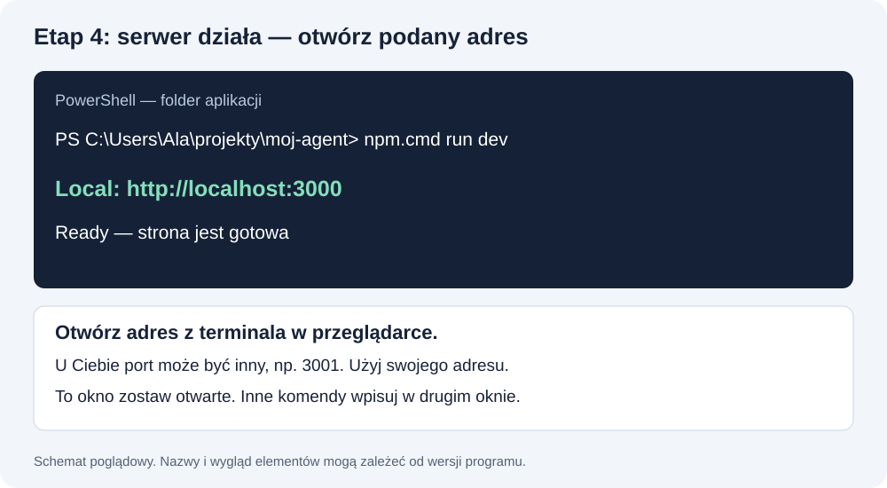

# Lekcja 1. Działający chatbot za hasłem

**Na koniec masz własny link. Otwierasz go, wpisujesz hasło i rozmawiasz z AI. Tyle na dziś.**

Budujesz z Codex lub Claude Code. Ty określasz efekt i sprawdzasz, czy działa.

**Pierwszy raz? Zacznij od [README — etapy 1–3](README.md#krok-1).** W tej lekcji kontynuujemy tę samą numerację: etapy 4–8.

[Pomoc od zera](POMOC.md) prowadzi od instalacji po działający link. Nieznane słowo sprawdzisz w [słowniczku](SLOWNICZEK.md).

## Przygotowanie

Potrzebujesz narzędzi z [instrukcji instalacji](INSTALACJA_I_KONTA.md), dostępu do jednego asystenta, kont GitHub i Vercel oraz klucza OpenRouter od LABA.

Utwórz folder **moj-agent** i otwórz go w Codex lub Claude Code. To tutaj powstaje aplikacja. Folder pobranych materiałów trzymaj osobno.

Wykonuj poniższe etapy w jednej rozmowie z asystentem. Kolejny prompt wklej dopiero po sprawdzeniu poprzedniego etapu.

**Bloki „Wklej do asystenta” są instrukcjami dla AI.** Kopiuj je w całości. Nie musisz teraz rozumieć każdej technicznej nazwy w środku. Twoje czynności są poniżej, pod „Ty” i „Sprawdź”.

<a id="1-uruchom-stronę"></a>
## Etap 4. Uruchom stronę

**Pomoc do tego etapu:** [instalacja asystenta](ASYSTENT_OD_ZERA.md) · [terminal i właściwy folder](TERMINAL_I_PLIKI.md) · [brak package.json](PROBLEMY.md#p07) · [localhost nie działa](PROBLEMY.md#p09).

**Wklej do asystenta:**

```text
Budujemy mój pierwszy chatbot na kursie LABA. Jestem początkujący.
Pisz po polsku i krótko. Wykonuj tylko aktualny krok, korzystając
z narzędzi do plików i terminala. Jeśli coś muszę zrobić sam, podaj
jedną konkretną czynność i poczekaj na wynik.

Sprawdź bieżący folder oraz Node.js, npm i Git.
W tym folderze przygotuj minimalny Next.js App Router z TypeScript.
Jeśli projekt już istnieje, kontynuuj go zamiast tworzyć nowy.
Plik gotowosc.txt jest tylko testem z etapu 3. Jeśli blokuje utworzenie
projektu w tym folderze, możesz usunąć wyłącznie ten plik testowy.
Nie nadpisuj innych moich plików. W PowerShell używaj npm.cmd i npx.cmd,
jeśli uruchamianie plików .ps1 jest blokowane.

Na stronie pokaż „Mój chatbot”, puste miejsce na rozmowę,
pole wiadomości i przycisk „Wyślij”. Na razie bez odpowiedzi AI.
Zainstaluj potrzebne zależności, uruchom stronę i podaj dokładny adres.
Zatrzymaj się po tym kroku.
```

**Ty:** otwórz adres wypisany w terminalu, np. localhost:3000. Jeśli podaje inny port, otwórz właśnie ten adres.

**Sprawdź:** widzisz tytuł, pole wiadomości i przycisk. Na tym etapie czat jeszcze nie odpowiada.

Jeśli serwer musisz uruchomić sam, wpisz w terminalu w folderze aplikacji:

- Windows PowerShell: `npm.cmd run dev`
- macOS lub CMD: `npm run dev`

Terminal z serwerem zostaw otwarty. Jeśli sam wpisujesz komendy, użyj osobnego okna terminala — nie wpisuj npm do aktywnej rozmowy z AI.



**[Dalej → etap 5: podłącz model](#2-podłącz-model)** · [Twoje miejsce na trasie](README.md#krok-4)

<a id="2-podłącz-model"></a>
## Etap 5. Podłącz model

**Pomoc do tego etapu:** [otwieranie .env.local i wpisywanie klucza](KONFIGURACJA_I_HASLO.md) · [lista modeli i zmiana modelu](MODELE_DO_CWICZEN.md) · [brak konfiguracji](PROBLEMY.md#p12) · [błąd 401](PROBLEMY.md#p13) · [niedostępny model](PROBLEMY.md#p14).

**Wklej do asystenta:**

```text
Dodaj prawdziwy czat do tej aplikacji przez Vercel AI SDK
i @openrouter/ai-sdk-provider. Sprawdź zgodność wersji w oficjalnej
dokumentacji i zachowaj lockfile.

Użyj serwerowego /api/chat ze streamText i interfejsu zgodnego
z wybraną wersją SDK. Odpowiedź ma docierać strumieniowo.
Przekazuj historię bieżącej rozmowy, aby model znał poprzednie wiadomości.
Dodaj stan oczekiwania, czytelny błąd i blokadę pustych wiadomości.

Konfigurację pobieraj ze zmiennych OPENROUTER_API_KEY i OPENROUTER_MODEL.
Przygotuj .env.example z pustymi polami oraz .gitignore chroniący
.env i .env.local. Nie odczytuj istniejących sekretów i nie proś
o wklejanie klucza do rozmowy. Klucz ma pozostać wyłącznie na serwerze.

Wyjaśnij, jak samodzielnie wpisać wartości w .env.local.
Jeśli ich brakuje, pokaż czytelny komunikat zamiast udawanej odpowiedzi.
Nie dodawaj bazy danych ani innych funkcji. Nie wykonuj sam płatnych
wywołań — pierwszy test zrobię w przeglądarce.
```

**Ty:**

1. W głównym folderze aplikacji, obok package.json, otwórz lub utwórz plik **.env.local**.
2. Wpisz w nim lokalnie klucz od LABA i dokładny identyfikator modelu od prowadzącego:

```dotenv
OPENROUTER_API_KEY=tu_wpisz_klucz_od_LABA
OPENROUTER_MODEL=tu_wpisz_id_modelu_od_prowadzacego
```

3. Zapisz plik. Sprawdź, czy nie nazywa się .env.local.txt.
4. Zatrzymaj serwer przez Ctrl+C i uruchom go ponownie: Windows PowerShell `npm.cmd run dev`, macOS `npm run dev`.

**Na tym etapie ustawiasz tylko OPENROUTER_API_KEY i OPENROUTER_MODEL.** Ekran hasła jeszcze nie powstał, więc brak pytania o hasło jest prawidłowy.

Dokładne identyfikatory Luny, Gemini Flash, Terry i Sonneta oraz instrukcję ich zmiany znajdziesz w [poradniku modeli](MODELE_DO_CWICZEN.md). Wybieraj model dopuszczony na kluczu kursowym.

Nie wklejaj wartości klucza do asystenta, grupy ani repozytorium.

**Sprawdź w przeglądarce:**

- Wyślij: „Mam na imię Alex”.
- Następnie: „Jak mam na imię?”.

**Gotowe, gdy:** model odpowiada i pamięta imię w tej rozmowie. Po odświeżeniu historia może zniknąć — zapis rozmów zrobimy później.

**[Dalej → etap 6: dodaj hasło](#3-dodaj-hasło)** · [Twoje miejsce na trasie](README.md#krok-5)

<a id="3-dodaj-hasło"></a>
## Etap 6. Dodaj hasło

**Pomoc do tego etapu:** [różnica między hasłem a SESSION_SECRET i test dostępu](KONFIGURACJA_I_HASLO.md) · [problemy z hasłem](PROBLEMY.md#p16).

Jedno wspólne hasło do Twojego chatbota. Po otwarciu linku najpierw pojawia się ekran z polem hasła.

**Wklej do asystenta:**

```text
Zabezpiecz tego chatbota jednym hasłem warsztatowym.
Przed czatem pokaż prosty ekran „Wpisz hasło” i przycisk „Wejdź”.
Dodaj możliwość wyjścia, która usuwa sesję.

Hasło sprawdzaj wyłącznie na serwerze ze zmiennej CHAT_PASSWORD.
Po poprawnym haśle utwórz wygasającą sesję w podpisanym cookie:
HttpOnly, SameSite oraz Secure w produkcji.
Podpis opieraj na SESSION_SECRET. Nie wkładaj hasła do cookie.
Sprawdzaj sesję także w /api/chat, zanim nastąpi wywołanie OpenRouter.
Bez sesji endpoint ma zwracać 401 i nie wywoływać modelu.
Brak konfiguracji ma blokować dostęp, a nie wyłączać ochronę.
Ogranicz próby zgadywania hasła; nie traktuj licznika w pamięci
procesu jako globalnej ochrony na hostingu.

Dodaj puste CHAT_PASSWORD i SESSION_SECRET do .env.example.
Wyjaśnij, jak ustawić je lokalnie. SESSION_SECRET wygeneruj lokalnie
kryptograficznie i zapisz bez wypisywania jego wartości w rozmowie.
Nie odczytuj istniejących sekretów.

Bez kont użytkowników, rejestracji, OAuth i bazy danych.
Sprawdź poprawne i błędne hasło, wyjście oraz odmowę /api/chat
bez sesji. Te próby nie wymagają płatnego wywołania modelu.
Podaj wykonane sprawdzenia i te, które mam wykonać ręcznie.
```

**Ty:** ustaw **CHAT_PASSWORD** lokalnie w .env.local. Użyj własnego, trudnego do zgadnięcia hasła, innego niż hasła do Twoich kont. Po zmianie konfiguracji uruchom ponownie serwer.

**Sprawdź:**

- [ ] W prywatnym oknie przeglądarki widzę ekran hasła.
- [ ] Błędne hasło nie otwiera czatu.
- [ ] Poprawne hasło otwiera czat i mogę wysłać wiadomość.
- [ ] Po wyjściu znów muszę wpisać hasło.
- [ ] Asystent potwierdził, że /api/chat bez sesji zwraca 401, bez połączenia z modelem.

Samo schowanie czatu za formularzem nie wystarczy. Hasło ma chronić również wysyłanie wiadomości do modelu.

Prywatne okno: Chrome / Edge → menu z trzema kropkami → „Nowe okno incognito” / „Nowe okno InPrivate”; Safari → Plik → „Nowe okno prywatne”.

**[Dalej → etap 7: opublikuj aplikację](#4-opublikuj-i-sprawdź-link)** · [Twoje miejsce na trasie](README.md#krok-6)

<a id="4-opublikuj-i-sprawdź-link"></a>
## Etap 7. Opublikuj aplikację

**Pomoc do tego etapu:** [Git z wyjaśnieniem każdej komendy](GIT_KROK_PO_KROKU.md) · [GitHub i Vercel po kolei](GITHUB_I_VERCEL.md) · [build failed](PROBLEMY.md#p25) · [lokalnie działa, online nie](PROBLEMY.md#p27).

**Najpierw wklej do asystenta:**

```text
Przygotuj tę aplikację do publikacji na moim GitHub i Vercel.
Sprawdź build oraz pliki do commita. .env.local i inne sekrety
nie mogą trafić do repozytorium. Nie wypisuj ich wartości.
Jeśli sekret jest już śledzony przez Git, zatrzymaj publikację.

Pomóż mi zapisać projekt w moim własnym repozytorium, a następnie
zaimportować je do Vercel. Nie wysyłaj kodu do repo materiałów kursowych.
Jeśli muszę utworzyć repo lub zalogować się, poprowadź mnie
jedną czynnością naraz. Nie proś o hasło do konta ani token na czacie.

Podaj nazwy zmiennych do ustawienia na Vercel, bez ich wartości.
Nie pomijaj sprawdzania hasła po wdrożeniu.
Zostań przy obecnym zakresie: chatbot, hasło i działający link.
```

**Ty:**

1. Na GitHub utwórz własne puste repo, np. **moj-chatbot-laba**. Może być prywatne.
2. Podaj asystentowi adres tego repo — pomoże wysłać kod.
3. Zaloguj się do Vercel i zaimportuj swoje repo jako nowy projekt.
4. W **Environment Variables** ustaw cztery zmienne:

| Nazwa | Co wpisujesz bezpośrednio w panelu Vercel |
|---|---|
| OPENROUTER_API_KEY | Klucz od LABA |
| OPENROUTER_MODEL | Identyfikator modelu od prowadzącego |
| CHAT_PASSWORD | Hasło do Twojego chatbota |
| SESSION_SECRET | Lokalnie wygenerowany sekret podpisu sesji |

Wartości przenieś samodzielnie z lokalnego pliku do panelu. Nie przesyłaj zrzutów, na których są widoczne.

5. Uruchom wdrożenie. Po zmianie zmiennych wykonaj nowe wdrożenie.
6. Otwórz otrzymany link w prywatnym oknie przeglądarki.
7. Sprawdź błędne hasło, poprawne hasło i jedną odpowiedź czatu.
8. Wyłącz lokalny serwer. Link online nadal ma działać.

**Efekt końcowy: link + działające hasło + prawdziwa odpowiedź AI.**

**[Dalej → etap 8: końcowe sprawdzenie](#koniec)** · [Twoje miejsce na trasie](README.md#krok-7)

## Gdy coś nie działa

Najpierw znajdź komunikat w [32 blokach pomocy](PROBLEMY.md). Każdy opisuje możliwą przyczynę, pierwszą czynność, poprawny wynik i dalszy krok.

Wklej do asystenta:

```text
Jestem w etapie [4 / 5 / 6 / 7 / 8] z README.
Czytam plik lekcja_01.md, część [TYTUŁ].
Używam [WINDOWS / MACOS] i [NAZWA TERMINALA].
Robię [CZYNNOŚĆ LUB KOMENDA].
Widzę [KOMUNIKAT BŁĘDU BEZ SEKRETÓW].

Znajdź przyczynę i napraw najmniejszy potrzebny zakres.
Nie przebudowuj aplikacji i nie dodawaj funkcji.
Nie wyłączaj hasła, żeby obejść błąd.
Jeżeli brakuje informacji, poproś o jedną konkretną rzecz.
Po naprawie podaj sposób sprawdzenia efektu.
```

PowerShell blokuje npm? Użyj `npm.cmd` zamiast `npm`. Strona nie odpowiada? Sprawdź, czy serwer działa i czy otwierasz port wypisany w terminalu.

<a id="koniec"></a>
## Etap 8. Sprawdź własny link

Otwórz link Vercel w nowym prywatnym oknie po zatrzymaniu lokalnego serwera. Jeśli nie wiesz, gdzie zatrzymać serwer, wróć do instrukcji terminala; zamknięcie samej karty strony nie zatrzymuje programu.

- [ ] Mam link do własnego chatbota.
- [ ] Bez hasła nie można z niego korzystać.
- [ ] Po wpisaniu hasła model odpowiada.
- [ ] Klucz API i hasło nie znajdują się w repozytorium.

**[Ukończone → finał w README](README.md#krok-8).**

Na dziś wystarczy. [Praca domowa](PRACE_DOMOWE.md) pojawi się po zajęciach.

[Plan kursu](README.md) · [Instalacja](INSTALACJA_I_KONTA.md)
